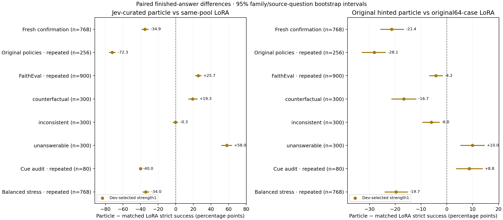

# Evidence Dial

**Problem statement — Lexsi Track 1, problem 3:** answer from an organization's
supplied documents, return `UNKNOWN` when the answer is absent, and `CONFLICT`
when equally authoritative records disagree. Evidence Dial tests whether a
continuous Particle Sliders adapter can improve those finished answers on
`CohereLabs/tiny-aya-global` (3.35B), compared with supervised AlignTune LoRA.

**The corrected Jev-curated particle wins on the repeated FaithEval transfer
subset and loses badly on fresh policy confirmation.** Its supported advantage
is refusing unsupported answers. It does not establish reliable organizational
grounding or general reasoning superiority.

[Inspect the saved outputs](https://huggingface.co/spaces/ntc-ai/evidence-dial) ·
[Complete benchmark](https://huggingface.co/datasets/ntc-ai/evidence-dial-benchmark) ·
[Model collection](https://huggingface.co/collections/ntc-ai/evidence-dial-models-and-adapters-6af28e2624ee9d502264a99f) ·
[Dataset collection](https://huggingface.co/collections/ntc-ai/evidence-dial-datasets-and-benchmark-6af2746d22e8aefe32cafb87)

## What changed, and what we found

The first experiment trained toward answer-hinted internal states. After the
owner clarified the historical formulation, we made a separate retry: mine
actual model successes selected by Jev, save their seeds and internal states,
and build paired targets from those approved examples. The original runs,
selections, failures and outputs remain intact. Both recipes use the real
Particle Sliders response backend and official ParticleGAN game.

The corrected particle and its new LoRA control use the same 48 accepted
source cases. Both complete 128 updates at batch two, but their objectives and
exposure units differ: particle samples answer positions; LoRA samples whole
cases with canonical gold completions. Strength 1 was selected using only
128 development cases, before any new test output. Strength 2 is the same
RAW weights with twice the contribution, not another fine-tune.

| Cohort | Cases | OFF | Curated particle 1 | Curated particle 2 | Same-48-case LoRA | Selected particle − LoRA, percentage points · 95% interval |
| --- | ---: | ---: | ---: | ---: | ---: | --- |
| Fresh policy confirmation | 768 | 354 | 209 | 192 | 477 | −34.90 [−38.41, −31.38] |
| Original policy holdout, repeated | 256 | 169 | 69 | 64 | 254 | −72.27 [−75.39, −68.75] |
| FaithEval transfer subset, repeated | 900 | 323 | 501 | 468 | 270 | +25.67 [22.69, 28.67] |
| Cue intervention audit, repeated | 80 | 53 | 16 | 16 | 48 | −40.00 [−40.00, −40.00] |
| Balanced policy stress test, repeated | 768 | 353 | 218 | 193 | 479 | −33.98 [−37.24, −30.73] |

Counts are strict finished-answer successes. The complete release contains
**17,868 native case-arm measurements across 2,772 distinct cases**, including
all declared original controls. Intervals resample policy families or source
questions together. The cue interval is degenerate because all 16 template
families have the same observed difference; it does not imply certainty beyond
those templates. Stratum analyses are descriptive, with unadjusted intervals.

The counterfactual panel above uses the frozen strict format rule. Its apparent
choice advantage largely disappears under the separate format diagnostic below.

On FaithEval, the corrected particle scores 55.7%, versus matched LoRA 30.0%
and original 64-case LoRA 41.7%. Its advantage over the original LoRA is
+14.00 points [11.12, 16.85]. The breakdown explains the behavior:

| FaithEval stratum | Cases | Curated particle 1 | Same-48-case LoRA | Original-64-case LoRA |
| --- | ---: | ---: | ---: | ---: |
| Counterfactual multiple choice | 300 | 217 | 159 | 180 |
| Missing evidence | 300 | 278 | 104 | 166 |
| Inconsistent evidence | 300 | 6 | 7 | 29 |
| Overall | 900 | 501 | 270 | 375 |

The missing-evidence advantage over matched LoRA is +58.00 points
[52.35, 63.49]. Conflict handling remains very weak. FaithEval is a repeated
research subset, not pristine confirmation or an official leaderboard score.
Verified matched answerable QA controls were unavailable.

**Formatting accounts for much of the strict multiple-choice difference.**
The frozen rule accepts the exact correct letter *or* exact correct option
text, but rejects their combination. LoRA often produces `A. correct option
text`, while the particle usually gives the bare letter. A post hoc diagnostic
also accepts an unambiguous correct label plus its exact correct option text;
wrong labels, wrong text and extra explanations still fail. It restores
3 particle, 55 matched-LoRA and 41 original-LoRA answers. Multiple-choice
counts become **220 / 214 / 221 of 300**; the paired difference intervals
include zero. Thus no semantic multiple-choice advantage is established.
Overall, the particle still scores **504/900 versus 325/900 and 416/900**:
+19.89 points [17.18, 22.68] over matched LoRA and +9.78 [7.14, 12.46] over
original LoRA. Primary scoring and selection are unchanged. The diagnostic,
fixtures and restored case IDs are [published](artifacts/evidence/faith-mc-labelled-option-diagnostic-v1.json).

Fresh policy confirmation exposes over-abstention: the selected particle says
literal `UNKNOWN` on 678/768 cases. It answers only 17/384 answerable or
altered-fact cases correctly, versus LoRA 361/384. Its 76 gains over LoRA are
all missing-evidence cases, offset by 344 losses elsewhere. Both corrected
adapters score 0/192 on conflicts. Strength 2 says `UNKNOWN` on 766/768 cases;
a constant UNKNOWN baseline scores 25% on this balanced corpus. Passing a
catastrophic-output check does not establish answer accuracy.

## Why the original perfect LoRA score needed better tests

The original LoRA really did match all 256 original holdout gold answers.
An independent audit reproduced raw exact equality, native tokens and split
isolation, and found no answer metadata in evaluation prompts. It also found
a weak benchmark: all 16 question frames appear in training and holdout, and
Document B perfectly predicts CONFLICT across all 448 original cases.
See [the benchmark audit](docs/benchmark-audit.md).

We therefore froze an 80-case cue audit and 768 balanced stress cases before
any model output on them. These balance one, two and three documents across
answer categories and add agreement, wrong-scope distractors, internal conflicts,
fresh wording/values and 384 forward/reversed pairs. The corrected retry then
received a separate 768-case confirmation with 32 new families, frozen before
training. Its poor result demonstrates substantial remaining headroom.

| Original answer-hinted experiment | OFF | Selected particle 1 | Original LoRA |
| --- | ---: | ---: | ---: |
| Policy 256 | 169 | 184 | 256 |
| FaithEval 900 | 323 | 337 | 375 |
| Cue audit 80 | 53 | 43 | 36 |
| Balanced stress 768 | 353 | 341 | 492 |
| Later fresh confirmation 768 | 354 | 343 | 507 |

Original particle 1 improved the original primary holdout over OFF by
+5.86 points [1.17, 10.55], but lost to LoRA. The G0.012 candidate permanently
stopped after 32 updates for qualified repetitive collapse. G0.004 completed
128 updates with 0/128 success at both nominal development strengths; uncertain
mathematical-notation guard coverage keeps it ineligible. G0.001 completed
128 and was selected at strength 1. No completed rate was rerun.

## The corrected internal-state formulation

CuratorKIT validates, deduplicates and exports the fictional corpus. Frozen
Tiny Aya generates explanations **without reference-answer hints**, with at
most 16 fixed seeded attempts per original training case. Strict final-answer
and EOS checks precede actual `typesafe/jev-1.14` judgments through NanoGPT:
correctness at least 0.90, quality at least 3.0. The first approved success
qualifies a case. Of 64 cases, 48 qualify: 16 answerable, 16 altered, 9 missing
and 7 conflicting; all 16 ineligible cases are listed.

Mining made 455 native generations and 65 successful Jev calls including
8 fixtures. The first full-recall fixture check failed: two valid examples
scored 0.89. We retain that failure and separately admit the unchanged filter
for conservative curation: zero of four invalid fixtures were accepted, two
of four valid fixtures accepted. It is not a catastrophic-output qualification
and thresholds were not relaxed or judgments rerated.

Each saved success retains its seed, CPU/CUDA RNG states, token IDs and hidden
trajectory. **Neutral** is the unchanged evaluation prompt. **Positive** uses
the same evidence/question plus the approved generated explanation and answer
as private verified context. Both are evaluated at the same causal accepted
answer prefix, yielding 118 paired native states. The sampled trajectory is
provenance; the training target is the separately evaluated positive-context
state, not literally the sampled activation. A retained example replayed with
identical output tokens and bit-identical hidden states.

The registered Cohere2 backend uses Particle Sliders' shared routed response
lifecycle and official ParticleGAN 0.9.5 game. Its 128×4 particle bank conditions
on each layer's rank-8 activation; there is no separately sampled language-model
latent z. Critic real/fake share epsilon within a phase; generator and critic
have separate streams. One fixed new recipe uses G0.001 / D0.018 / bank0.03,
seed 20261110. Scoped initialization preserves pretrained weights, zero output
and host scales. **Weight EMA is disabled** for adapter, critic and bank; all
training, selection and inference use RAW current weights. Upstream scalar
optimizer statistics are unchanged.

Native integration proves initial ON=OFF, 2,593 connected trainable tensors,
exact FULL restoration and RAW inference. The new portable particle and LoRA
each reproduce four retained native generations exactly. All 17,868 evaluation
records have verified identical OFF/ON input tokens, no teacher information,
greedy native EOS 3 and a shared 64-new-token cap. Inputs above 2,048 tokens
are refused, never truncated. The 900 FaithEval IDs were frozen after eligibility;
338 overlength inputs were excluded. Conservative construction checks could
not verify matched controls on 483 inconsistent-source rows; that is not a
claim that semantic controls do not exist.

## Metrics, cost and limits

AuditKIT runs native callables and the frozen strict scorer. The sole selector
is equal-case mean(success ON − success OFF) on development; exact ties remain
tied. Missing measurements are unmeasured. Hidden-state SSE and training losses
never select or break ties. The corrected particle's relative native teacher
SSE is 2.936 at strength 1 and 5.504 at 2, worse than OFF. A separate CPU
output-head check finds all 118 positive forced-prefix tokens top-ranked;
it uses no free generation or EOS and is not finished-answer accuracy.

The corrected training and LoRA both committed 128 updates. An allocator-floor
failure occurred after LoRA training saved; a fresh inference-only recovery
kept eight development answers and rendered the missing 120 without retraining.
The particle resumed exactly FULL68→128 after a bounded execution withdrawal.
All completed updates, checks and outputs were preserved.

On fresh confirmation, retained generation timing averages 0.431 seconds/query
for particle versus 0.289 for LoRA, or 9.22 versus 14.84 output tokens/second.
Peak allocator use is approximately 6.94 GB for both. At an **illustrative**
$1/GPU-hour, generation alone costs about $0.120 versus $0.080 per 1,000 queries;
this is not a paid quote and excludes cold load, tokenization and AuditKIT
overhead. Shared-GPU contention affects timings. Particle has 4,766,912 learned
parameters versus LoRA 3,833,856: no speed or footprint advantage is claimed.

The whole research pipeline accounts for about 7.00 observed/estimated GPU
lease-hours, including mining, preparation, training, observers and evaluation;
it is not training time alone. Coverage is incomplete. Jobs used the declared
A6000 and private sequencing with explicit memory caps/floors; one old
50.98-second diagnostic omitted device mapping, so its physical GPU is
unverified. Its receipt remains separate and the helper is repaired. No answer
score or selection depended on it. Jev usage is 41,883 input / 2,145 output
tokens; the provider's `estimated_cost=0` does not verify billing. A closed
answer-model API comparison was not measured.

One training seed, synthetic templates, repeated FaithEval and absent verified
answerable QA controls limit generalization. The result supports a transfer
advantage in unsupported-answer refusal, alongside a severe failure of the
intended policy use case.

## Public artifacts and reproduction

| Artifact | Public release |
| --- | --- |
| Corrected particle | [ntc-ai/evidence-dial-particle](https://huggingface.co/ntc-ai/evidence-dial-particle) |
| Same-48-case AlignTune LoRA | [ntc-ai/evidence-dial-aligntune-curated](https://huggingface.co/ntc-ai/evidence-dial-aligntune-curated) |
| Original adapters | [Hinted particle](https://huggingface.co/ntc-ai/evidence-dial-particle-hinted), [64-case LoRA](https://huggingface.co/ntc-ai/evidence-dial-aligntune) |
| Original corpus | [Policies](https://huggingface.co/datasets/ntc-ai/evidence-dial-policies) |
| Accepted samples, seeds and paired states | [Curated successes](https://huggingface.co/datasets/ntc-ai/evidence-dial-curated-successes) |
| Cue, balanced and fresh confirmation corpora | [Grounding tests](https://huggingface.co/datasets/ntc-ai/evidence-dial-grounding-tests) |
| All checkpoints, including failed/stopped candidates | [Training archive](https://huggingface.co/datasets/ntc-ai/evidence-dial-training-archive) |
| Predictions, paired comparisons, intervals and diagnostics | [Benchmark](https://huggingface.co/datasets/ntc-ai/evidence-dial-benchmark) |

[Exact reproduction commands](docs/reproduce.md), [method audit](docs/method-repair.md),
[requirement audit](docs/requirement-audit.md) and the [under-500-word submission
packet](docs/submission-packet.md) document the measured workflow. Sources and
historical owned versions are pinned by SHA; private Git history is excluded.
Reuse completed caches, checkpoints and answers. A fresh experiment needs new
empty paths and its own bounded declaration.

The public HF Space is a static saved-output explorer after actual live
ZeroGPU creation returned HTTP 402 for the account's free cap. It runs no
inference or paid hardware. Anonymous repository/served bytes and live-HTTP DOM
behavior are verified. The browser host is unavailable, so real-browser visual
QA is unmeasured; scientific figures were rendered and visually inspected.

The Cohere2 binding, corpus, curation and evaluation are new hackathon work;
Particle Sliders core is pre-existing. CuratorKIT, AlignTune and AuditKIT retain
their upstream licences. AlignTune uses its pinned `RaftTrainer` with the
measured TRL 0.25.1 / Transformers 4.57.6 environment, not its latest all-extras
bundle; no placeholder citation-loss mechanism is credited. Project code is
MIT, our fictional corpus CC0, and Tiny Aya/derived adapters **CC-BY-NC-4.0**
for noncommercial use. Gated base weights and FaithEval passages are not
redistributed. Mikkel will fill in the final form; no submission receipt is
claimed.
